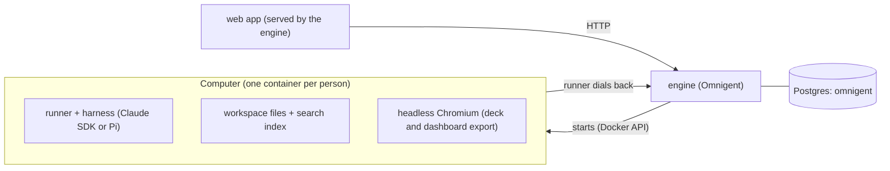

# superchat

## Architecture



- **web** (`web/app`): the interface. One Conversation, its side chats and forks, the dock
  (Inbox, Mini Apps, Automations, Files) and the Activity panel. It only renders state and sends
  intent. The engine serves it, and it talks to the engine directly; there is no app server
  (see [ADR 0015](docs/adr/0015-no-app-server-the-web-talks-to-the-engine.md)).
- **engine** (`engine/omnigent`): the agent server. It owns sessions, the Conversation and side
  chats, Helpers, memory, approvals, artifacts, scheduled tasks (Automations), the model layer, who is asking (from an SSO broker header) and
  the agent bundle (`deployment/engine`). Any website can drive it.
- **Computer** (`deployment/computer.Dockerfile`, with what it ships from `host/`): a container per person where the agent actually runs:
  Omnigent's runner (host) image plus Superchat's additions, started by the engine over the Docker
  socket (the Docker counterpart of Omnigent's Kubernetes launcher), home on its own volume.
  It holds the person's files, indexes them for search, and renders decks and dashboards to
  PowerPoint and PDF with a headless browser. The agent has no desktop or browser control.
- **Postgres**: one database, `omnigent`, with the engine in its own schema.

## Requests

1. The person sends a message in the web app; it goes straight to the
   engine.
2. The engine runs a turn in the person's Computer: the runner calls the model, the tools run there
   (files, shell, Python, export), and long or multi-step work goes to Helpers.
3. Results stream back to the web app as events: the reply, cards, artifacts and Activity.
4. Anything that acts in the person's name waits in the Inbox for approval.

## Run with Docker

```sh
./deployment/setup.sh
```

It writes `.env` from `.env.docker.example`, fills in the secrets, then builds the two images and
starts the stack. The same by hand, from the repo root:

```sh
docker compose --env-file .env -f deployment/compose.yaml --profile build build computer
docker compose --env-file .env -f deployment/compose.yaml build engine
docker compose --env-file .env -f deployment/compose.yaml up -d --wait
```

Everything about building and shipping is in [`deployment/`](deployment/README.md): two
Dockerfiles, one Compose file, one build script.

| Service | Image |
|---|---|
| `postgres` | `postgres:16-alpine`, one database with an `engine` schema |
| `engine` (web `5173`, engine `8012`) | `deployment/engine.Dockerfile`: the engine package, the built `web/app` it serves, and the agent bundles, config templates and `start.sh` at `/opt/bundle` |
| `computer` (build only) | `deployment/computer.Dockerfile`: the runner each person gets, on plain Ubuntu 24.04 |

`.env` keys: `OMNIGENT_PROXY_SECRET` and `OMNIGENT_VAULT_KEY` (engine
secrets), `ANTHROPIC_API_KEY`, and `ENGINE_PUBLIC_URL` (where each Computer
reaches the engine; default `http://host.docker.internal:8012`). Set `LITELLM_BASE_URL` and
`LITELLM_API_KEY` to send every model call through an existing LiteLLM proxy instead of the
Anthropic key: the engine adds the key (it never enters a Computer), claude-sdk reaches the proxy's
`/v1/messages` and Pi its Chat Completions. No model is configured by name: an admin picks the
default and light models in Settings > Models. Behind a firewall, see
[docs/SETUP.md](docs/SETUP.md#restricted-networks) for mirrors and a company CA.

A shared runner host container (`omnigent host`) is not offered: the engine trusts identity only
from a sign-in broker's signed headers, and `omnigent host` has no way to present them or to sign in, so it
cannot register a host for a person. Each person's Computer is their runner host.

## Layout

| Path | What |
|---|---|
| `web/app` | web app |
| `web/packages/*` | shared contracts, the engine client, UI |
| `engine/omnigent` | engine |
| `deployment/engine` | agent instructions and tool bundle |
| `deployment/computer.Dockerfile` | Computer image |
| `host/` | what ships into each Computer besides the engine package: helper commands (`bin/`), the dashboard template, deck export and pptx assets (`share/`), and their tests (`tests/`) |

## License

Apache-2.0. See [LICENSE](./LICENSE) and [NOTICE](./NOTICE) for third-party credits.
