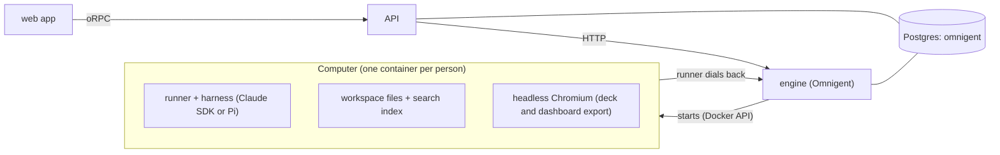

# superchat

## Architecture



- **web** (`apps/web`): the interface. One Conversation, its side chats and forks, the dock
  (Inbox, Mini Apps, Automations, Files) and the Activity panel. It only renders state and sends
  intent.
- **API** (`apps/api`): sign-in, accounts and authorization. It checks who is asking and passes
  each call to the engine; it holds no agent logic.
- **engine** (`engine/omnigent`): the agent server. It owns sessions, the Conversation and side
  chats, Helpers, memory, approvals, artifacts, scheduled tasks (Automations), the model layer and
  the agent bundle (`infra/omnigent`). Any website can drive it.
- **Computer** (`infra/sandboxes/computer`): a container per person where the agent actually runs:
  Omnigent's runner (host) image plus Superchat's additions, started by the engine over the Docker
  socket (the Docker counterpart of Omnigent's Kubernetes launcher), home on its own volume.
  It holds the person's files, indexes them for search, and renders decks and dashboards to
  PowerPoint and PDF with a headless browser. The agent has no desktop or browser control.
- **Postgres**: one database, `omnigent`, with the API and the engine in their own schemas.

## Requests

1. The person sends a message in the web app; the API checks the session and forwards it to the
   engine.
2. The engine runs a turn in the person's Computer: the runner calls the model, the tools run there
   (files, shell, Python, export), and long or multi-step work goes to Helpers.
3. Results stream back to the web app as events: the reply, cards, artifacts and Activity.
4. Anything that acts in the person's name waits in the Inbox for approval.

## Run with Docker

```sh
./scripts/setup.sh
```

It writes `.env` from `.env.docker.example`, fills in the secrets, then builds and starts
Omnigent's own Compose file, unchanged, with one Superchat file on top (re-run it, or this, after a
change):

```sh
docker compose --env-file .env \
  -f engine/omnigent/deploy/docker/docker-compose.yaml \
  -f infra/compose/docker-compose.superchat.yaml up --build
```

The images are Omnigent's own (`engine/omnigent/deploy/docker/Dockerfile`, built as
`omnigent-server` and `omnigent-host`) plus thin layers for what Superchat adds:

| Service | Image |
|---|---|
| `postgres` | Omnigent's Postgres, one database with an `app` and an `engine` schema |
| `omnigent` (`8012`) | the engine: `infra/omnigent/Dockerfile`, Omnigent's server image + `infra/omnigent` (agent bundles, config, `start.sh`) at `/opt/bundle` |
| `computer` (build only) | the runner each person gets: `infra/sandboxes/computer/Dockerfile` on Omnigent's host image, on plain Ubuntu 24.04 |
| `api`, `worker`, `web` (`5173`) | one app image, `infra/compose/Dockerfile` |

`.env` keys beyond the app's own: `OMNIGENT_PROXY_SECRET` and `OMNIGENT_VAULT_KEY` (engine
secrets), `ANTHROPIC_API_KEY`, and `ENGINE_PUBLIC_URL` (where each Computer
reaches the engine; default `http://host.docker.internal:8012`). Set `LITELLM_BASE_URL` and
`LITELLM_API_KEY` to send every model call through an existing LiteLLM proxy instead of the
Anthropic key: the engine adds the key (it never enters a Computer), claude-sdk reaches the proxy's
`/v1/messages` and Pi its Chat Completions. No model is configured by name: an admin picks the
default and light models in Settings > Models. Behind a firewall, see
[docs/SETUP.md](docs/SETUP.md#restricted-networks) for mirrors and a company CA.

A shared runner host container (`omnigent host`) is not offered: the engine trusts identity only
from the API's signed headers, and `omnigent host` has no way to present them or to sign in, so it
cannot register a host for a person. Each person's Computer is their runner host.

## Layout

| Path | What |
|---|---|
| `apps/web` | web app |
| `apps/api` | API |
| `apps/worker` | background jobs for the API |
| `packages/*` | shared contracts, adapters, UI, database client |
| `engine/omnigent` | engine |
| `infra/omnigent` | agent instructions and tool bundle |
| `infra/sandboxes` | Computer image |

## License

Apache-2.0. See [LICENSE](./LICENSE) and [NOTICE](./NOTICE) for third-party credits.
