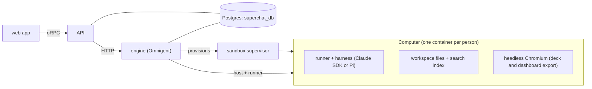

# superchat

## Architecture



- **web** (`apps/web`): the interface. One Conversation, its side chats and forks, the dock
  (Inbox, Mini Apps, Automations, Files) and the Activity panel. It only renders state and sends
  intent.
- **API** (`apps/api`): sign-in, accounts and authorization. It checks who is asking and passes
  each call to the engine; it holds no agent logic.
- **engine** (`engine/omnigent`): the agent server. It owns sessions, the Conversation and side
  chats, Helpers, memory, approvals, artifacts, scheduled tasks (Automations), the model layer and
  the agent bundle (`infra/omnigent`). Any website can drive it.
- **supervisor** (`infra/sandboxes/supervisor`): starts and stops each person's Computer.
- **Computer** (`infra/sandboxes/computer`): a container per person where the agent actually runs.
  It holds the person's files, indexes them for search, and renders decks and dashboards to
  PowerPoint and PDF with a headless browser. The agent has no desktop or browser control.
- **Postgres**: one database, `superchat_db`, with the API and the engine in their own schemas.

## Requests

1. The person sends a message in the web app; the API checks the session and forwards it to the
   engine.
2. The engine runs a turn in the person's Computer: the runner calls the model, the tools run there
   (files, shell, Python, export), and long or multi-step work goes to Helpers.
3. Results stream back to the web app as events: the reply, cards, artifacts and Activity.
4. Anything that acts in the person's name waits in the Inbox for approval.

## Run with Docker

One Compose project: Postgres, the engine (published on `8012`), the supervisor, the API, the
worker and the web app (`5173`). `./scripts/setup.sh` writes `.env` from `.env.docker.example`
and fills in its secrets; then:

```sh
docker compose --env-file .env -f infra/compose/docker-compose.yml up -d --build
```

Add overlays with more `-f` files:

| Overlay | What |
|---|---|
| `docker-compose.litellm.yml` | all model calls through an existing LiteLLM proxy |
| `docker-compose.litellm-local.yml` | a local LiteLLM proxy on `4000` instead (sample models in `litellm/config.yaml`) |
| `docker-compose.postgres-host.yml` | Postgres on `127.0.0.1:5433` for host tools |

`.env` keys beyond the app's own: `OMNIGENT_PROXY_SECRET` and `OMNIGENT_VAULT_KEY` (engine
secrets), `ANTHROPIC_API_KEY` (models without LiteLLM), `LITELLM_BASE_URL` and `LITELLM_API_KEY`
(LiteLLM), optionally `SUPERCHAT_CLAUDE_MODEL` and `OMNIGENT_HELPER_MODEL_FAST` (model ids as the
provider or proxy names them), `TAVILY_API_KEY`, and `ENGINE_PUBLIC_URL` (where each Computer
reaches the engine; default `http://host.docker.internal:8012`).

With LiteLLM, claude-sdk calls the proxy's Anthropic Messages endpoint (`/v1/messages`) and Pi
calls its Chat Completions (`/v1/chat/completions`, or `/v1/messages` for Claude models); the
model pickers list the proxy's `/v1/models`.

A shared runner host container (`omnigent host`) is not offered: the engine trusts identity only
from the API's signed headers, and `omnigent host` has no way to present them or to sign in, so it
cannot register a host for a person. Each person's Computer is their runner host.

## Layout

| Path | What |
|---|---|
| `apps/web` | web app |
| `apps/api` | API |
| `apps/worker` | background jobs for the API |
| `packages/*` | shared contracts, adapters, UI, database client |
| `engine/omnigent` | engine |
| `infra/omnigent` | agent instructions and tool bundle |
| `infra/sandboxes` | supervisor and Computer image |

## License

Apache-2.0. See [LICENSE](./LICENSE) and [NOTICE](./NOTICE) for third-party credits.
